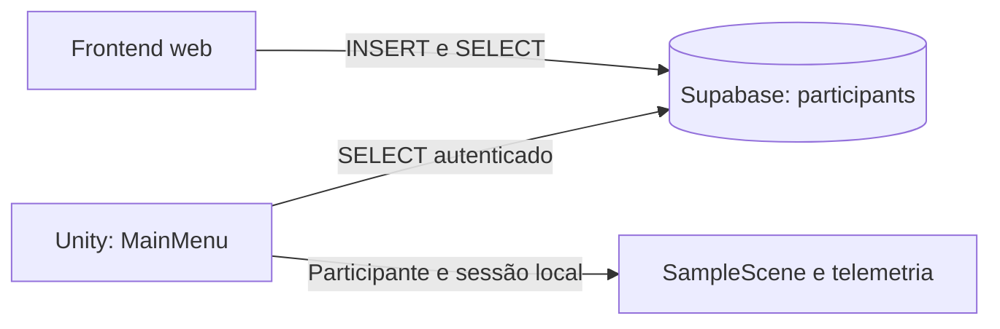

# Permissão de cadastro e lista do Unity independente do frontend

## Por que o login funciona, mas cadastrar pode ser recusado

O Supabase Auth valida e-mail/senha e fornece um token. O acesso a public.participants é outra autorização: depende dos privilégios da tabela/colunas e de uma política RLS de INSERT que aceite o usuário autenticado e os valores do cadastro.

O SQL inicial do projeto revogava privilégios de anon e authenticated. A política de leitura apresentada depois libera SELECT, mas não concede INSERT. O script `Supabase/003_frontend_participants.sql` foi preparado para liberar ambas as operações ao responsável indicado; ele precisa ser executado no banco remoto pelo dono do projeto.

Não foi possível inspecionar as políticas remotas diretamente nesta entrega. Uma recusa de cadastro pode significar privilégio de INSERT ausente, política ausente, UUID diferente do usuário do login ou valores que não atendam às condições da política. Não é necessário trocar a chave pública nem liberar acesso anônimo para resolver isso.

## Como liberar o responsável

1. Abrir `Supabase/003_frontend_participants.sql` na raiz do projeto.
2. Substituir **COLE_UUID_DO_RESPONSAVEL** pelo UUID da conta que entra no frontend, em **Authentication > Users** do projeto `qvszuzmwyfuyydfjjvxb`.
3. Copiar o script inteiro para o **SQL Editor** desse mesmo projeto e executar. O script verifica que a conta existe antes de aplicar as permissões.
4. Voltar ao frontend, recarregar com Ctrl+F5 e tentar cadastrar. A migração não foi executada automaticamente pelo agente.

O UUID do responsável é diferente de participant_code. A conta autorizada pode cadastrar nomes de participantes; cada cadastro recebe seu próprio código N de 32 caracteres. Nomes iguais são permitidos.

Se o cadastro continuar recusado após executar 003, rodar `Supabase/004_diagnosticar_permissoes_participants.sql` no SQL Editor. Esse diagnóstico é somente leitura e mostra os GRANTs por coluna, o estado de RLS e as condições das políticas. Conferir se pode_inserir_codigo e pode_inserir_nome são true e se a política INSERT compara auth.uid() com o UUID correto. A consulta feita no SQL Editor como administrador não testa, por si só, a permissão do usuário comum pela API.

O frontend agora diferencia a recusa de cadastro de uma falha de login: mantém o acesso e informa que a conta ainda não está autorizada a cadastrar. Não exibe o corpo bruto de erros do banco.

## Arquitetura: as aplicações não se chamam

Depois de o banco confirmar um cadastro, o frontend e seu servidor Node podem ser fechados. O Unity consulta o Supabase diretamente usando sua própria configuração e seu próprio login. Ele não lê o HTML, a lista em memória do navegador, o servidor localhost ou um arquivo gerado pelo frontend.

## Atualização automática adicionada ao Unity

Na MainMenu existente, o GameObject MenuScript agora possui **ParticipantAutoRefresh**, com referências preenchidas para MenuIntegrationController e ParticipantSelectionUI e intervalo padrão de **5 segundos**. O Inspector permite alterar esse intervalo, com mínimo de 2 segundos.

- [ParticipantRepository.cs](../Assets/MainProjeto/Telemetria/Participants/ParticipantRepository.cs): consultas paginadas à tabela participants.
- [ParticipantRosterSync.cs](../Assets/MainProjeto/Telemetria/Participants/ParticipantRosterSync.cs): snapshot confirmado, comparação por UUID/nome e detecção de inserção, remoção ou renomeação; classe sem MonoBehaviour e sem dependência de frontend/UI.
- [ParticipantAutoRefresh.cs](../Assets/MainProjeto/MenuPrincipal/Scripts/ParticipantAutoRefresh.cs): agenda as atualizações enquanto o menu está autenticado, sem iniciar outra consulta automática se já houver uma em andamento. Solicita atualização ao recuperar o foco.
- [ParticipantSelectionUI.cs](../Assets/MainProjeto/MenuPrincipal/Scripts/ParticipantSelectionUI.cs): apresenta o snapshot e reutiliza as linhas existentes por UUID, mantendo seleção, interação XR e posição de rolagem nas atualizações em segundo plano.
- [MenuIntegrationController.cs](../Assets/MainProjeto/MenuPrincipal/Scripts/MenuIntegrationController.cs): valida o participante na lista disponível, invalida seleção que deixou de estar disponível, adota nome atualizado e interrompe consulta pendente ao iniciar a experiência.

As atualizações normais em segundo plano não desligam Iniciar nem recriam todos os botões. Se uma consulta falhar, a identidade escolhida não é apagada como se tivesse sido excluída, mas o início fica bloqueado até uma consulta válida. Se uma consulta válida confirmar que o registro saiu da lista autorizada, a seleção preparada é invalidada.

O botão Atualizar continua disponível. As mudanças aparecem no próximo ciclo de consulta, acrescido do tempo de rede; não é uma assinatura Realtime. A atualização exige Unity em Play Mode/aplicativo em execução, internet e login do responsável. Ela para ao sair do menu ou iniciar o simulador; a coleta em SampleScene permanece independente da lista.

## Testar

1. Executar 003 com o UUID correto e cadastrar alguém no frontend.
2. Abrir ou recarregar MainMenu no Unity e entrar em Play Mode. Fazer o login do responsável.
3. Abrir a lista de participantes. Fazer um novo cadastro no frontend enquanto o menu continua aberto.
4. Confirmar que aparece no próximo ciclo automático. Fechar o frontend e verificar que Atualizar no Unity continua funcionando.
5. Selecionar alguém, confirmar a identificação e iniciar. A coleta até a última quest mantém o fluxo anterior.

Validação automatizada: **230 verificações C#**, incluindo inserção/removação/renomeação na lista, manutenção da identidade por UUID, consultas sem alterações, falha de rede, cancelamento e limpeza na troca de conta; **20 testes do frontend**; compilação contra as bibliotecas locais do Unity e validação do YAML/referências da MainMenu.

Não houve execução de migração remota, teste com a conta real ou Play Mode/headset nesta entrega. A telemetria continua local; esta alteração não libera INSERT em sessions nem upload de arquivos.

Referências: [Supabase RLS](https://supabase.com/docs/guides/database/postgres/row-level-security) e [privilégios por coluna](https://supabase.com/docs/guides/database/postgres/column-level-security).
